<p align="center">
  
</p>

<h1 align="center">pylos-mcp</h1>

<p align="center"><strong>Your mail client shows you the message. pylos-mcp shows your assistant what it hides.</strong></p>

<p align="center"><em>An email MCP server for Gmail, Outlook and Microsoft 365, iCloud and any IMAP mailbox, built so that every message reaches your assistant as data, not instructions.</em></p>

<p align="center">
  <a href="https://www.npmjs.com/package/pylos-mcp"></a>
  <a href="https://github.com/adamVass/pylos-mcp/actions/workflows/ci.yml"></a>
  <a href="LICENSE"></a>
  <a href="https://www.bestpractices.dev/projects/15385"></a>
</p>

<p align="center">
  <a href="https://github.com/adamVass/pylos-mcp/releases/latest/download/pylos-mcp.mcpb"></a>
  <a href="https://cursor.com/install-mcp?name=pylos-mcp&config=eyJjb21tYW5kIjoibnB4IiwiYXJncyI6WyIteSIsInB5bG9zLW1jcCJdLCJlbnYiOnsiUFJPVklERVIiOiJnbWFpbCIsIkVNQUlMX1VTRVIiOiJ5b3VAZXhhbXBsZS5jb20iLCJFTUFJTF9QQVNTV09SRCI6InlvdXItYXBwLXBhc3N3b3JkIn19"></a>
  <a href="https://insiders.vscode.dev/redirect/mcp/install?name=pylos-mcp&config=%7B%22command%22%3A%22npx%22%2C%22args%22%3A%5B%22-y%22%2C%22pylos-mcp%22%5D%2C%22env%22%3A%7B%22PROVIDER%22%3A%22gmail%22%2C%22EMAIL_USER%22%3A%22you%40example.com%22%2C%22EMAIL_PASSWORD%22%3A%22your-app-password%22%7D%7D"></a>
</p>

<p align="center">
  <picture>
    <source media="(prefers-color-scheme: dark)" srcset="assets/readme/xray-dark.svg">
    
  </picture>
</p>

Anyone can put text in your inbox, and once an AI assistant reads that inbox, they can put text in front of the assistant too. pylos-mcp lets Claude, or any MCP client, search, read and draft your mail while treating every message as input from a stranger, and it points out what a message is hiding before the assistant acts on it.

Every message is marked as data, with a Warnings line for what looks off, such as hidden text, phrases aimed at an AI, lookalike letters or a failed DMARC check. By default the assistant can read and draft. Moving, sending and deleting stay off until you turn them on, sending then reaches only the addresses you list, and there is no `bcc` anywhere. It runs on your machine and works with Gmail, Outlook and Microsoft 365, iCloud, Yahoo, GMX, Fastmail, mailbox.org, Posteo, Proton through Bridge, or a server of your own.

pylos-mcp connects to your mail provider, and with Outlook to Microsoft's sign in service. What the assistant reads goes to your AI client and, through it, to the model provider you use, as anything else you show your assistant does. Attachments you ask for are saved to your Downloads folder.

## The lethal trifecta

Simon Willison calls it [the lethal trifecta](https://simonwillison.net/2025/Jun/16/the-lethal-trifecta/): an AI agent with access to private data, exposure to untrusted content and the ability to communicate externally. An assistant reading your email has the first two by design, because your inbox is private and anyone can write to it. Stealing what it read takes the third, a way to send it somewhere else.

Sending is off by default. Drafts wait in your Drafts folder until you send them yourself, and enabling sending still requires a recipient allowlist. No tool attaches a file from your disk or adds a forwarding rule.

The third leg can still come from elsewhere in the same client, such as a tool that fetches web pages or runs shell commands. Image markup inside a message is neutralized, but the model can still write an image link of its own, which a client that loads images would fetch. When the assistant reads your mail, keep tools that reach the internet out of that conversation.

Fencing reduces prompt injection risk, and nothing eliminates it. The model still reads text written by strangers, so check what the assistant tells you about your mail before acting on it.

## Quick start

pylos-mcp works with any client that runs local MCP servers. It runs locally through `npx` and needs Node.js 22 or later. Every route below starts from example values, so replace the address and password with your own. Use an app password, not your account's regular password, and for Outlook no password at all. [Provider setup](#provider-setup) says where to get one.

**Claude Desktop.** Download [pylos-mcp.mcpb](https://github.com/adamVass/pylos-mcp/releases/latest/download/pylos-mcp.mcpb), open it, and fill in the form Desktop shows.

**Claude Code.** `--scope user` makes it available in every project. `EMAIL_PASSWORD_CMD` keeps the password out of your shell history and Claude's config: it runs a command that prints the password, here a macOS keychain lookup. Store the password there first with `security add-generic-password -s pylos-mcp -a you@example.com -w`, which asks for it.

```sh
claude mcp add pylos-mcp --scope user -e PROVIDER=gmail -e EMAIL_USER=you@example.com \
  -e EMAIL_PASSWORD_CMD="security find-generic-password -s pylos-mcp -w" -- npx -y pylos-mcp
```

**Cursor and VS Code.** Use the buttons above, then put your own values in the config they create.

<details>
<summary><b>Config files for Cursor, VS Code, Windsurf, Cline and other clients</b></summary>

Most clients, Cursor's `.cursor/mcp.json` and Claude Desktop's `claude_desktop_config.json` among them, take this entry:

```json
{
  "mcpServers": {
    "pylos-mcp": {
      "command": "npx",
      "args": ["-y", "pylos-mcp"],
      "env": {
        "PROVIDER": "gmail",
        "EMAIL_USER": "you@example.com",
        "EMAIL_PASSWORD": "your-app-password"
      }
    }
  }
}
```

VS Code's `.vscode/mcp.json` names the key `servers`:

```json
{
  "servers": {
    "pylos-mcp": {
      "command": "npx",
      "args": ["-y", "pylos-mcp"],
      "env": {
        "PROVIDER": "gmail",
        "EMAIL_USER": "you@example.com",
        "EMAIL_PASSWORD": "your-app-password"
      }
    }
  }
}
```

</details>

**Outlook and Microsoft 365** take `PROVIDER=outlook` and no password at all, so remove `EMAIL_PASSWORD` from the entry, or the server refuses to start. The first time the assistant reads mail, your browser opens Microsoft's sign in page.

Restart your client fully after any change, since tools register only at startup and toggling the server off and on is not always enough. Then ask the assistant to list your mail folders. A list means it works.

If the Claude Desktop extension shows "Server disconnected", the reason is in Desktop's `main.log` in `~/Library/Logs/Claude` on macOS or `%APPDATA%\Claude\logs` on Windows, on a line starting with `pylos-mcp:`.

## Capabilities

Each capability is a separate switch, and turning one on leaves the others as they are. Reading is always on, drafting starts on, and everything else stays off until you list it in `CAPABILITIES`. A tier that is off has its tools left out of the tool list entirely, so a model never learns they exist.

| Tier | Default | Tools |
|---|---|---|
| `read` | always on | `search_emails`, `get_email`, `get_thread`, `get_attachment`, `list_folders` |
| `drafts` | on | `create_draft` |
| `manage` | off | `move_email`, `set_flags` |
| `send` | off | `send_email` |
| `delete` | off | `delete_email` |
| `sieve-read` | off | `list_sieve_scripts`, `get_sieve_script` |

Enable more with a list, for example `CAPABILITIES=drafts,manage,delete`. Moving a message into Trash is a delete by another route, so `move_email` refuses Trash unless `delete` is on too.

`get_thread` lists the conversation a message belongs to, meaning the messages it replies to and the replies that name it or an earlier message, from its own folder, INBOX and Sent. Each message is then read with `get_email`, which adds its warnings. Both `create_draft` and `send_email` take `in_reply_to` to thread a reply under the original in mail clients. Sending the reply marks the original as answered.

`search_emails` pages through results filtered by free text, `from`, `to`, `subject`, `since` and `before` dates, or unread and flagged status. `get_email` shows sent and arrival times, Cc, and Reply-To when it differs from From. With `manage` on, `set_flags` marks messages read, unread, flagged or unflagged.

`get_attachment` saves a file to `DOWNLOAD_DIR` without reading its contents into the conversation. Saved files are readable only by you, never replace an existing file, and on macOS carry the quarantine flag, so an app among them goes through Gatekeeper before it runs.

## What this can never do

These limits are enforced by the server.

- No raw HTML reaches the model. Bodies come from the plain text part when one exists, or are converted to text otherwise. Invisible characters that hide instructions from a reader while staying readable to a model are stripped.
- Bodies, subjects, sender names and Sieve scripts are fenced with markers that are neutralized inside the content, so a message cannot forge its way out. The server writes the lines outside the fence. Any short mailbox value repeated there, such as a folder name, is cleaned and length capped first.
- No `bcc` field exists on drafts or sent mail. A bcc recipient gets a full copy while appearing nowhere in the message, which is exactly what an injected email would ask for.
- Drafts and sent mail can attach only files already in the mailbox, named by folder, uid and part. No tool takes a file path or attaches anything from your disk.
- Deleting moves a message to Trash. There is no expunge or permanent delete. A server that cannot move messages is refused. What your provider later does with Trash is up to the provider.
- Sieve access stays read only. No tool writes filter rules, which can forward, reply and notify even after you revoke the app password or uninstall this server.

Sending stays closed with `send` on until `SEND_ALLOWLIST` names recipients. It accepts single addresses, domains as `*@example.com`, or `*` alone for anyone. With no allowlist, the refusal explains how to allow specific recipients or anyone. See [SECURITY.md](https://github.com/adamVass/pylos-mcp/blob/main/SECURITY.md) for the design notes.

## Suspicion warnings

Six detectors annotate `get_email` results for hidden text, instruction patterns, encoded blobs, sender mismatch, mixed scripts and DMARC failure. The Warnings line sits above the content, written in the server's own words and never quoting the content that triggered it. The image above shows five detectors firing on one message.

```
Warnings: hidden_text (412 hidden characters via display:none), encoded_blob (base64 run of 600 characters)
```

The message always comes back alongside its warnings. Each detector has its own switch in the configuration reference below. See [detector details](https://github.com/adamVass/pylos-mcp/blob/main/SECURITY.md#suspicion-warnings) for thresholds, false positives and DMARC trust selection.

## Provider setup

Set `PROVIDER` to one of `gmail`, `outlook`, `icloud`, `yahoo`, `gmx`, `fastmail`, `mailbox.org` or `posteo` and the matching servers and ports fill themselves in.

Gmail, iCloud, Yahoo and Fastmail need an app password. Google requires 2-Step Verification and an account policy that allows app passwords. iCloud requires two factor authentication on the Apple Account. mailbox.org, GMX and Posteo accept the account password, though an app password is the wiser choice.

Outlook and Microsoft 365 use `PROVIDER=outlook` with no password. On Outlook.com, turn IMAP on under Settings, Mail, Forwarding and IMAP. Your browser opens Microsoft's sign in page on the first mail read. Sign in, allow access, then ask again.

### Work accounts

Your organization may require admin approval, and sending may require an administrator to enable SMTP AUTH. See [work accounts](https://github.com/adamVass/pylos-mcp/blob/main/docs/providers.md#work-accounts) for the consent link and tenant settings.

The [full provider guide](https://github.com/adamVass/pylos-mcp/blob/main/docs/providers.md) covers passwords, Microsoft permissions and signing out, Proton Mail through Bridge, and your own servers.

## Configuration reference

All configuration is environment variables. They are checked when the server starts, so a typo fails at once with a message saying what to fix, rather than at the first tool call. An empty value counts as unset, since bundle managers fill optional fields left blank with empty strings.

<details>
<summary><b>All variables</b></summary>

| Variable | Default | Notes |
|---|---|---|
| `PROVIDER` | none | One of `gmail`, `outlook`, `icloud`, `yahoo`, `gmx`, `fastmail`, `mailbox.org`, `posteo`. Fills in IMAP, SMTP and Sieve hosts and ports. `outlook` signs in through the browser instead of a password. |
| `EMAIL_USER` | required | Account login. |
| `EMAIL_PASSWORD` | none | App password. Either this or `EMAIL_PASSWORD_CMD` is required, except with `outlook`, which takes neither. |
| `EMAIL_PASSWORD_CMD` | none | Command that prints the password, such as a keychain lookup or `pass`, so the secret never sits in the client's config file. It has 60 seconds to finish. |
| `MS_CLIENT_ID` | pylos-mcp's own | With `outlook` only. The application ID of an app registered in your organization's tenant. |
| `MS_TENANT` | `common` | With `outlook` only. Your tenant ID or domain, needed when `MS_CLIENT_ID` names an app registered for one tenant only. |
| `IMAP_HOST` / `IMAP_PORT` | preset / `993` | Explicit values for your own server. Set either to override the preset. |
| `IMAP_STARTTLS` | `false` | Connect in plain text and switch to TLS with STARTTLS before logging in, for servers that offer IMAP only that way. The default port becomes `143`. A server that will not switch is refused, so the login is never sent unencrypted. |
| `SMTP_HOST` / `SMTP_PORT` | preset / `465`, `587` for `outlook` | Required only when `send` is enabled. |
| `SIEVE_HOST` / `SIEVE_PORT` | `IMAP_HOST` / `4190` | Used only when `sieve-read` is enabled. |
| `CAPABILITIES` | `drafts` | Tiers beyond `read`, which is always included, separated by commas. |
| `MAX_BODY_KB` | `64` | Message body truncation limit. |
| `MAX_ATTACHMENT_MB` | `25` | Attachment size cap. A download is checked against the size the server declares before any bytes arrive. When composing, it caps all attachments of one message together, shared by every message being composed at once. |
| `DOWNLOAD_DIR` | `~/Downloads` | Where `get_attachment` writes files. |
| `SEND_SESSION_CAP` | `5` | Successful `send_email` calls allowed per server run, counted again from zero after a restart. |
| `SEND_SAVE_COPY` | `true` | Save a copy of each sent message to the Sent folder, marked read. Turn off for providers that already file sent mail themselves (Gmail does), which would otherwise show duplicates. |
| `SEND_ALLOWLIST` | none (sending closed) | Addresses or `*@domain` patterns separated by commas, or `*` alone to allow anyone. With `send` enabled and no value set, every send is refused and the refusal explains this variable. An explicitly empty value also allows nobody. An entry that could never match, such as a bare domain, fails at startup. |
| `DRAFTS_NO_RECIPIENTS` | `false` | When `true`, `create_draft` rejects `to` and `cc` entirely. Drafts carry no addressing and get it added later in your mail client. |
| `FLAG_HIDDEN_TEXT` | `true` | Warn when message HTML hides text with inline styles or `aria-hidden`. |
| `FLAG_INSTRUCTION_PATTERNS` | `true` | Warn when the body, subject, sender line or attachment names contain phrases addressing an AI. |
| `FLAG_ENCODED_BLOBS` | `true` | Warn on long runs of base64 or hex in the body. |
| `FLAG_SENDER_MISMATCH` | `true` | Warn when a Reply-To address sits on a different domain than the From address, or the From display name carries an address on another domain. |
| `FLAG_MIXED_SCRIPT` | `true` | Warn when a word mixes Latin letters with Cyrillic or Greek lookalikes. |
| `FLAG_DMARC_FAIL` | `true` | Warn when your own mail server's DMARC check failed. |
| `AUTHSERV_ID` | preset | Server names that start your provider's `Authentication-Results` headers, separated by commas, replacing the preset's. An entry starting with a dot matches any name ending in it. With none, `dmarc_fail` never fires. |
| `STRIP_HIDDEN_TEXT` | `false` | Drop detected hidden text from the body instead of only warning, with a note of how much was dropped. Needs `FLAG_HIDDEN_TEXT` on, and the combination with the detector off is refused at startup. |
| `FLAG_EXTRA_PATTERNS` | none | Phrases added to the instruction pattern set, separated by pipes, matched as literal text regardless of case. |
| `TLS_CA_FILE` | none | Path to a PEM CA certificate added as an extra trust anchor, for your own server with a private CA. Certificate verification cannot be turned off, this only extends what is trusted. Setting it trusts Node's bundled root store plus this file, so anchors added through `NODE_EXTRA_CA_CERTS` are not in that set. If you rely on those, point `TLS_CA_FILE` at the same certificate. |

</details>

## Maintenance expectations

pylos-mcp is built for the author's own daily use and maintained on that basis. Issues and pull requests are welcome, and [CONTRIBUTING.md](https://github.com/adamVass/pylos-mcp/blob/main/CONTRIBUTING.md) has a wishlist of directions that would help.

See [CONTRIBUTING.md](https://github.com/adamVass/pylos-mcp/blob/main/CONTRIBUTING.md#development) for development setup and tests. No test in this project connects to a real mailbox, in development or in CI.
